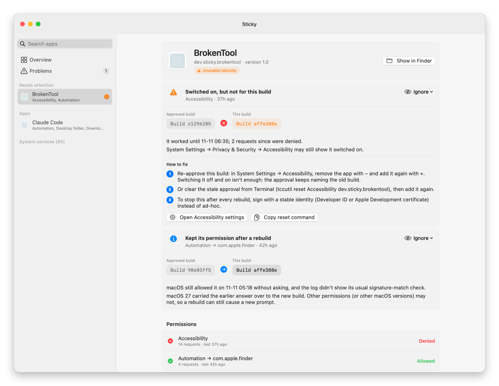
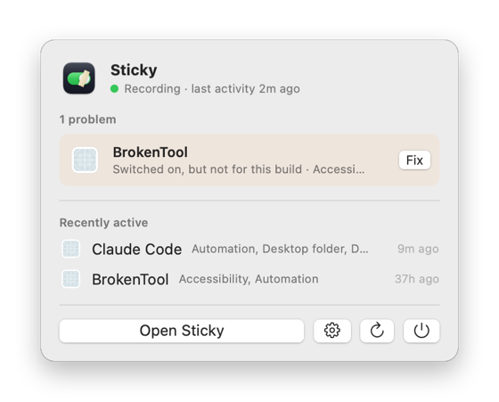

<p align="center">
  
</p>

<h1 align="center">Sticky</h1>

<p align="center">
  <strong>Find out why your Mac keeps asking for permissions, and make them stick.</strong>
</p>

<p align="center">
  <a href="https://github.com/amansriven/Sticky/releases/latest"></a>
  
  <a href="LICENSE"></a>
</p>

<p align="center">
  <a href="#install">Install</a> ·
  <a href="#what-sticky-finds">What it finds</a> ·
  <a href="#the-mac-app">Mac app</a> ·
  <a href="#command-line">Command line</a> ·
  <a href="#privacy">Privacy</a>
</p>

<p align="center">
  <picture>
    <source media="(prefers-color-scheme: dark)" srcset="docs/images/app-page-dark.png">
    
  </picture>
</p>

## Why

On macOS 27, apps keep asking for permissions you already granted. Some stop working while System Settings still shows them **switched on**. System Settings only shows the switch; it never says *why*.

macOS does write its reasoning to the system log for every permission request:
- which app asked, and which app it held responsible;
- which build your approval was saved for, and whether the running app matches it;
- what you answered.

Sticky records that log quietly in the background and turns it into a plain-English explanation, with the fix.

> [!TIP]
> One finding from building Sticky: after an app is rebuilt, **switching it off and on in System Settings doesn't help**. The saved approval still names the old build. Removing the app with **−** and adding it again with **+** does. Sticky tells you when you're in that situation.

## Install

```bash
brew install amansriven/tap/sticky
```

```bash
sticky install-agent
```

The second command starts recording in the background. It runs as you, with no `sudo` and no Full Disk Access. Sticky can only explain requests it saw, so start it before the next time something goes wrong.

## What Sticky finds

| | Finding | What happened |
|:-:|---|---|
| 🔌 | **Switched on, but not for this build** | Your approval names an earlier build of the app. The current build doesn't match, so access is denied without asking, while System Settings still shows it on. |
| 🔁 | **Asked again: the signing identity changed** | A rebuilt or updated app looked like a new app to macOS. |
| 📦 | **Asked again: the app moved** | The app is identified by its location, and it moved. |
| 🪪 | **Asked again: macOS blamed a different app** | Permissions belong to the app macOS holds responsible (often your terminal), not the tool you ran. |
| 🧹 | **Asked again: the saved answer was removed** | Same app, same place, but the approval was reset: by `tccutil`, in System Settings, or by a management profile. |
| 🚫 | **Denied: refused silently** | A "Don't Allow" is saved, so macOS refuses without asking. |
| 📉 | **Lost a permission it had** | A permission that's off by default, like Full Disk Access, was allowed before and is denied now. |
| ℹ️ | **Kept its permission after a rebuild** | For information: macOS carried an approval over to a new build. |

Every finding comes with steps and a button for the exact System Settings page, or the `tccutil` command that resets just that app. Sticky ignores refusals that are simply the default, such as Apple's own background services checking Full Disk Access. You can also **ignore** any finding yourself: once, for one of an app's permissions, or for the whole app.

## The Mac app



A native SwiftUI app with a window, a menu bar item and notifications:

- **Overview:** whether anything needs attention, recording status, and your apps' permission activity over 24 hours.
- **Problems:** each with the evidence ("approved build ✗ this build"), numbered fix steps, and **Ignore**.
- **App pages:** every permission an app asked for, its signing identity, and a day-by-day timeline.
- **Notifications:** about 10 seconds after an app silently loses a permission. Click one to open the app's page.
- **Settings:** open at login, Dock icon, notifications, history and ignored alerts.

It's built from source for now and needs only the Xcode command-line tools:

```bash
app/build.sh && open app/build/Sticky.app
```

<br clear="right">

> [!NOTE]
> The app is ad-hoc signed for local use. A signed, notarized download is planned.

## Command line

The same diagnosis works from the terminal:

```console
$ sticky why brokentool
BrokenTool  (dev.sticky.brokentool 1.0)
  Identity: ⚠ Ad-hoc signed: no developer identity. Its signature is a hash of this exact build, …

  Accessibility   (14 requests)
    ✗ Switched on, but not for this build
      Your approval is saved for the build signed as cdhash H"c1296205…".
      The current build is signed as cdhash H"affe388e…", which doesn't match it, so macOS denies access without asking.
      Fix: Re-approve this build: in System Settings → Accessibility, remove the app with − and add it again with + …
```

<details>
<summary><strong>All commands</strong></summary>

| Command | What it does |
|---|---|
| `sticky why APP` | Explain every permission an app asked for, with fixes. `APP` is a name, bundle id or path fragment. `--include-ignored` shows ignored findings too. |
| `sticky inspect PATH\|BUNDLE-ID` | An app's signing identity, and whether its permissions will survive updates |
| `sticky log` | Timeline of decisions: `--since 2h`, `--client`, `--service`, `--outcome denied`, `--json` |
| `sticky status` | Is the recorder running? When did it last see a log line? |
| `sticky ignore KEY` | Ignore one finding once (keys appear in `sticky why APP --json`) |
| `sticky ignore --app ID [--service NAME] [--target ID]` | Always ignore one of an app's permissions, or the whole app |
| `sticky ignores` · `sticky unignore ID` | List ignore rules, or remove one |
| `sticky report --json` · `sticky events ID --json` | Health and findings, or one app's decisions, as JSON (what the app reads) |
| `sticky install-agent` · `sticky uninstall-agent` | Start or stop background recording (`--dry-run` shows the LaunchAgent) |
| `sticky record` | Record in the foreground (Ctrl+C to stop) |

</details>

## Privacy

- **Everything stays on your Mac,** in `~/Library/Application Support/Sticky`. Nothing is sent anywhere.
- **Data is kept for 30 days.**
- **Sticky only reads.** The recorder runs `/usr/bin/log stream`, which needs no extra permissions. Sticky never changes a permission itself.
- **Light on resources:** about 0.03% of one CPU core and about 20 MB of memory, measured over 27 hours, including sleeps.

## Requirements and limits

- **macOS 27,** tested on 27.2.1. Earlier versions are untested.
- **The permissions log format is undocumented** and can change in any macOS update. `sticky status` lists log lines Sticky didn't recognise. If that list grows after an update, please [open an issue](https://github.com/amansriven/Sticky/issues).

<details>
<summary><strong>Uninstall</strong></summary>

```bash
sticky uninstall-agent
```

```bash
brew uninstall sticky
```

To delete recorded data too, remove `~/Library/Application Support/Sticky` and `~/Library/Logs/Sticky`.

</details>

<details>
<summary><strong>Development</strong></summary>

The engine is Python 3.10+ with no third-party packages. The app is Swift and SwiftUI, built with the command-line tools.

```bash
PYTHONPATH=src python3 -m unittest discover -s tests
```

```bash
app/test.sh
```

```bash
app/snapshot.sh /tmp/sticky-shots
```

The last one renders every page of the app, light and dark, to PNGs. Set `STICKY_BIN=$PWD/scripts/sticky-dev` to run the app against this checkout instead of Homebrew's `sticky`.

| Path | What it is |
|---|---|
| `src/sticky/` | The engine: log reading (`logsource`, `rules`, `assembler`), storage (`store`), recording (`recorder`, `agent`), identity (`identity`), diagnosis (`diagnose`), JSON for the app (`report`), and the `sticky` command (`cli`) |
| `app/` | The Mac app: `StickyCore` (models, CLI bridge, notification planning) and `StickyBar` (window, menu, settings) |
| `app/icon/` | `make-icon.swift` draws the app icon at every size; `concepts.swift` draws the alternatives that were considered |
| `tools/brokentool/` | A deliberately fragile, ad-hoc signed test app (`build.sh TAG`, then `run.sh` or `run.sh ax`) |
| `tests/fixtures/` | Real, anonymized permission logs from macOS 27.2.1 |
| `scripts/` | `sticky-dev` runs this checkout; `frame-screenshot.swift` frames README screenshots |
| `packaging/homebrew/` | The Homebrew formula (published in [amansriven/homebrew-tap](https://github.com/amansriven/homebrew-tap)) |
| `sticky-design.md` | Architecture, every experiment and its results, and what's next |

Recording your own log, for new fixtures:

```bash
/usr/bin/log stream --info --debug --style ndjson --predicate 'subsystem == "com.apple.TCC"' > tcc.ndjson
```

Use the full path: in zsh, plain `log` is a built-in command. Then run `sticky parse tcc.ndjson`.

</details>

## License

[MIT](LICENSE)
